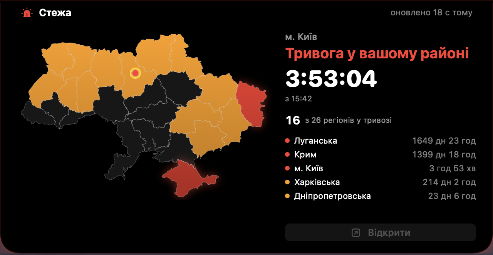
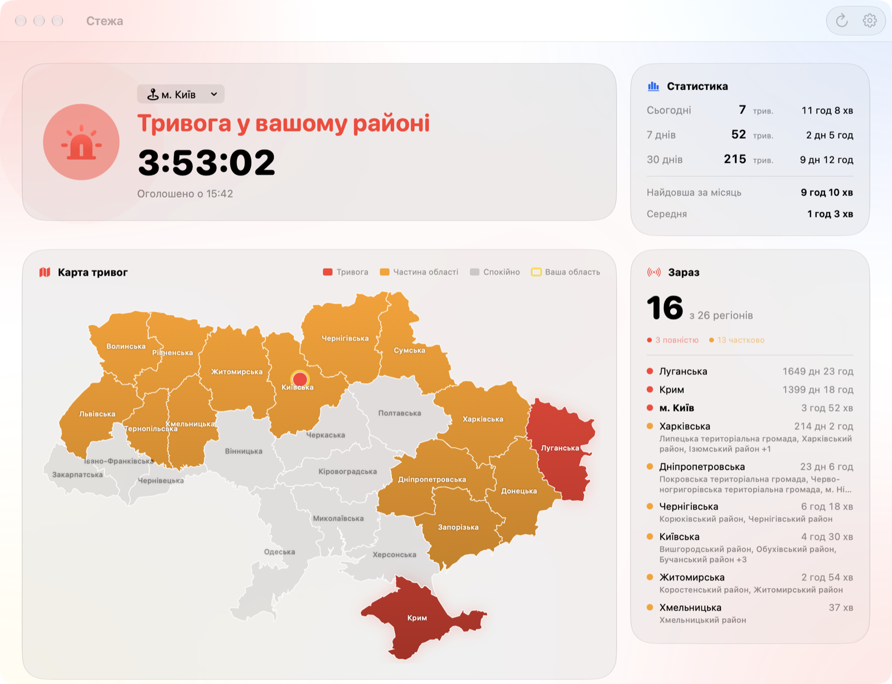

# Стежа · Stezha

**Air raid alerts for Ukraine, right in your MacBook's notch.** Hover the notch to open a live map with your area's status. Built natively in SwiftUI with Liquid Glass.

<p align="center"></p>

## Features

- **Notch island:** hover over the notch to see the map, your area's status, an alert timer and the oblasts on alert. It hides again when you move away. Nothing stays on screen in the background.
- **Your area:** the oblast, raion and city are detected from your location (or chosen by hand). The headline answers one question: *is there an alert where you are?*
- **Live map:** red means the whole oblast, orange means some of its raions. Hover an oblast for details.
- **Air threats:** Shahed drones, missiles, ballistic missiles, KABs and recon UAVs appear on the map with their flight direction. You also see counts by type and the nearest target with its distance. You can turn this off in Settings.
- **Statistics:** alerts today, over 7 and 30 days, total and longest duration, a 24‑hour timeline by raion, and how many regions were on alert during the day.
- **Notifications:** alert start, all clear, alerts elsewhere in your oblast, with a siren sound.
- **Menu bar icon** with a quick map and access to settings.
- Ukrainian and English, launch at login, and close to 0% CPU when idle.

<p align="center"></p>

## Install

Download `Stezha-x.y.dmg` from [Releases](../../releases) and drag **Стежа** into **Applications**.
The app isn't notarized, so the first time you open it, right-click → **Open** (or run `xattr -dr com.apple.quarantine "/Applications/Стежа.app"`).

Requires macOS 26 or later on Apple Silicon.

## Data

- [alerts.in.ua](https://alerts.in.ua) provides raion-level alerts and history. Release builds include a shared key, and you can add your own in Settings for faster updates.
- [ubilling.net.ua](https://ubilling.net.ua/aerialalerts/) is the fallback when the API is unavailable or rate limited.
- [NEPTUN](https://neptun.in.ua) provides live air threats. It aggregates monitoring channels and isn't an official warning system, so its data may be inaccurate or delayed.

> ⚠️ Стежа doesn't replace official sirens or the government alert app.

## Build

```sh
echo "YOUR_ALERTS_IN_UA_KEY" > .apikey   # optional, gitignored
./build.sh                               # build and install into /Applications
./scripts/package.sh                     # dist/Stezha-<version>.dmg
```

Oblast outlines come from [ukraine_geojson](https://github.com/EugeneBorshch/ukraine_geojson) and are simplified by `scripts/simplify_geo.py`.
